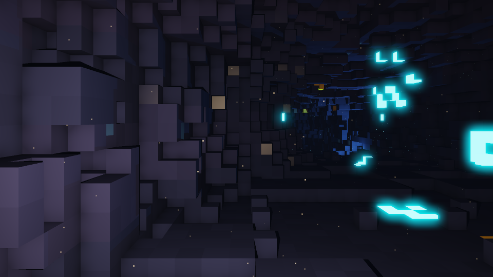

# UNDERTIME design

What has been decided for UNDERTIME, as of 2026-11-21. Sections marked **Open** or **Idea** are not decided yet.

The images in `Images/` are sketches made with standalone renderers (not CherryEngine). They show layout, mood and colour, not final quality. The four era images (`era_*.png`) were drawn before the switch to the all-voxel style, so use them for layout and mood only.

---

## 1. The pitch

You are a courier who has come to a valley that's on no map. You find a hidden cave and a mining town called **Stillwell** (placeholder name). You mine the mountain and sell what you find in town. The deeper you dig, the faster time runs outside: the town grows, booms, decays and finally disappears. When it's gone, the loop resets and you wake at the cave mouth on the day you arrived. You keep some upgrades and you know more each time. The goal is to reach the heart of the mountain before the town is gone.

The title is literal: you work **under** while time runs **over**.

---

## 2. The core rule: time runs faster the deeper you are

| Cave zone | 1 minute underground = | Cost of a dive |
|---|---|---|
| 1 | 1 hour outside | almost nothing |
| 2 | 1 day | a week |
| 3 | 1 week | a season |
| 4 | 1 month | years |
| 5 | 1 year | decades |

- The richer ore is deeper (copper from the top, silver, then gold, then Time crystal from about 64% depth), so every dive trades value for time.
- All ratios are tuning numbers in `Config.h`. These are starting values.
- Outside, time runs at a normal-feeling pace (a day takes a few minutes).

### What fast time does
- **Bills:** the company charges rent per outside day. Debt is **capped**: when you can't pay, it takes your gear back. It can't grow forever.
- **Savings:** money in the bank earns interest per outside day. The bank can **fail at an era change**, or the currency changes. "Money rots, ore doesn't."
- **Prices drift** with outside time, so you check the board when you come up.
- **The surface changes** through the eras (section 4).
- **You can see it from inside:** daylight at the cave mouth flickers between day and night faster the deeper you are.
- **The HUD watch** has two dials: your own time, and outside time spinning.
- **Limits on long stays:** lantern fuel burns in *your* time, so a zone 5 dive costs about a decade at most. The watch warns you before an era change. Ways out (rope, lift) shorten the trip up.
- **Idea:** carrying Time crystal in the backpack raises the time ratio.

---

## 3. The run (loop) structure

1. Wake at the cave mouth (Camp era, arrival day).
2. Mine, sell and upgrade. Each dive pushes the town through its eras.
3. Walking out into the **Gone** era ends the run: the courier's watch runs backwards, and you wake at the cave mouth again.
4. Finish by reaching the heart at the far wall before the town is gone.

| Resets each run | Kept across runs |
|---|---|
| Money, ore, the town's era | Upgrades bought with **Time crystal**, or found in the cave |
| Upgrades bought with **money** | Unsold Time crystal (ore turns back into stone when the loop resets) |
| **The cave:** a new seed every run ("the mountain rearranges itself") | Strange watches you've found. Later runs place only the missing ones. |
| | What you know: the valley never changes between runs |

- Every crystal is a choice: sell it now for money, or keep it for permanent upgrades.
- Rock gets harder with depth, and the sealed bands between zones need better picks, so you get deeper each run.

---

## 4. Eras

Six stages: five to play, plus the end. The town booms on your ore, then decays as your digging speeds up time.

| # | Era | Outside time since you arrived | Town | Mine entrance | At night | Shop sells |
|---|---|---|---|---|---|---|
| 1 | **Camp** | 0–2 years | tents, a campfire, one trading post | bare cave mouth | campfire | basic pick, lantern oil |
| 2 | **Settlement** | 2–10 | plank houses, the shops, clock tower being built | timber frame at the mouth | oil lamps in windows | bigger bag, rope |
| 3 | **Boomtown** | 10–30 | painted false fronts, bank, busy streets | rails, ore carts, a winding tower | lots of warm windows | better picks, dynamite; the bank opens |
| 4 | **Industry** | 30–60 | brick, chimneys, the clock tower finished | an engine house, an electric light at the mouth | electric streetlights | electric lamp, a lift in the mine |
| 5 | **Abandoned** | 60–100 | boarded windows, collapsed roofs, weeds | rusted and fenced off | one lit window: the last shopkeeper | leftover stock, high prices, a few rare items |
| — | **Gone** | 100+ | forest over grassy mounds, the clock face in the grass | the cave mouth, bare again | darkness | nothing; **the loop resets** |

- Era changes happen **only while you're underground**, so nothing pops in while you're looking.
- **Seasons** follow the outside clock. Coming out to snow after a summer descent is the cheapest way to feel lost time.
- **Industry with no railway:** the valley is cut off, so power has to come from the valley itself. **Proposal:** a power house on the river.
- Each era opens and closes places and shop stock, so you sometimes dive deep on purpose to reach the era that sells what you need.

Images: `era_1_camp.png`, `era_2_boomtown.png`, `era_3_abandoned.png`, `era_4_gone.png` (layout and mood only; the style is now voxel).

---

## 5. Story

**Decided (Claude's recommendation, chosen by the user):**
- **The courier** is delivering a letter to a town that's on no map. Near the mountain, their pocket watch runs backwards. Twist: they started the loop themselves on an earlier visit.
- **The town was founded on borrowed time:** the founders made a deal with the mountain, long rich lives in exchange for leaving the Time crystal in the rock. Mining breaks the deal, and that's why time speeds up.
- **16 Strange watches** belong to miners who went too deep. They're keys to the **heart**, a huge Time crystal at the far wall. Each watch has an engraving that tells part of the story.
- **The ending choice:** take the heart (free yourself) or leave it (save the town).
- **The valley is cut off.** The pass at the south end is blocked; you're stuck by the loop. Walking up the pass could end in fog that brings you back to the cave.
- **The clockmaker** sells the permanent upgrades and never ages, in any era. It's the biggest mystery in the valley.
- **The graveyard** fills up across the eras with names of people you met.

**Open:** a story for each resident and how each one changes per era (to be written later). Letters at era changes. How 100 years plays out, for example a last letter or a descendant.

---

## 6. The valley and the town

- **Size:** about 500 m across, about 2 minutes to walk (confirmed). Ringed by mountains, with deep forest between the places.
- **Not linear:** places are spread out, and you explore to find them. You navigate by sight (clock tower, smoke, lit windows) instead of a minimap. **Idea:** the lookout puts the valley map in your journal.
- **Paths:** roads, trails, and faint tracks that are easy to miss.
- **No railway:** the valley is cut off.

| # | Place | Purpose | Eras |
|---|---|---|---|
| 1 | The mine (hidden cave) | where you wake every loop | all |
| 2 | Town square | the four shops and the clock tower | 1–5 |
| 3 | Chapel and graveyard | graves pile up | 2–6 |
| 4 | Clockmaker's cottage | Time crystal upgrades; never ages; **easy to find**, by a footbridge with a water wheel | all |
| 5 | Founders' house | the deal with the mountain | 2–5 |
| 6 | Sawmill and bridge | grows with the town | 2–4 |
| 8 | Lookout | view of the whole valley | all |
| 9 | Old shaft | sealed early; maybe a second way in | ? |
| 10 | The big tree | grows every era (a clock anyone can read) | all |
| 11 | Homestead | outlying farm | 2–5 |
| 12 | Lake | quiet spot | all |
| 13 | The road in | the blocked pass | all |

(The valley map image still shows the railway station, number 7. It's been removed.)

### Town plan

- **Every building has its own plot:** a fence with gates, and a garden or yard that tells you who lives there (vegetable rows, orchard, ore yard, hedged formal garden).
- **Several routes between places:** roads, lanes, and shortcut footpaths (a back alley, stepping stones, a path through the orchard, a footbridge).
- The four shops share a small square (accepted for now). Everything else is spread out.

| # | Building | Purpose |
|---|---|---|
| 1 | Assay office | sell ore; prices drift. On the mine road. |
| 2 | General store | oil, rope, bag (money upgrades) |
| 3 | Bank | savings and interest; Boomtown to Industry |
| 4 | Post office | letters (the story); **idea:** delivery jobs for the courier |
| 5 | Saloon and inn | rumours, hints about watches, notice board |
| 6 | Blacksmith | pick upgrades and repairs (money) |
| 7 | Clockmaker | Time crystal upgrades (permanent) |
| 8 | Chapel and graveyard | story |
| 9 | Founders' house | story |
| 10–14 | Homes: the widow, the family, the doctor, the teacher, the boatman | residents whose stories run across the eras (to be written) |
| 15 | Sawmill | Settlement to Industry |

**Idea:** fences age with the eras. Broken fences open shortcuts and overgrown hedges block old ones.

---

## 7. Visual style

### One blocky style everywhere
- **Everything is made of 0.25 m voxels** with flat colour per block (no texture detail), slight brightness variation per block, and strong corner shading.
- **The cave is real voxels** (ray-marched and diggable).
- **Everything outside is designed as blocks** (terrain, buildings, fences, trees, props) and **baked into meshes** when the game loads, so it can use instancing and sun shadows. Far mountains may use 1 m blocks.
- **Only mountain rock is diggable.** Swinging the pick at built things gives the existing "hollow hit" bounce.
- The transition at the cave mouth is seamless: the same blocks and palette continue from the valley into the mountain.

### Colours carry meaning
- **Warm amber:** people and the present (lantern, town, timber).
- **Cyan:** time (Time crystal, the watch's outside dial, the daylight flickering at the cave mouth).
- **Violet:** the stopped moment at the far wall.

### The cave
| Zone | Stone | What you see |
|---|---|---|
| 1 | warm ochre | timber frames, lamps, rubble |
| 2 | rust brown | old shoring |
| 3 | grey-green | collapsed timber |
| 4 | deep blue | no human traces, big crystals |
| 5 | violet | dust frozen in the air |

- **Lantern-lit darkness:** cave ambient stays very low, so the lantern does nearly all the lighting.
- **Depth cues (approved):** strong corner shading, horizontal rock strata bands ("layers of time"), lamp props with point lights along tunnels, timber frames, rubble, tinted ambient fill, dust in the air, and later voxel shadows and bloom.
- Time crystal glows cyan (emissive) and is the only cold light.

### Outside
- Day/night and seasons follow the outside clock: snow on upward faces, leaf and grass colours, sky colour.
- Each era changes how places look, mostly by changing materials and their condition, not by building new models.

| Era | Materials | Shape | Colours | Light |
|---|---|---|---|---|
| Camp | canvas, raw logs | low, scattered | natural browns, cream canvas | campfire, lantern |
| Settlement | raw planks, shingle | one street forming | warm wood, some whitewash | oil lamps |
| Boomtown | painted planks, false fronts, porches | tall fronts, winding tower | red, ochre, teal, cream | many warm windows |
| Industry | brick, tin roofs, chimneys | bigger, two floors, smoke | brick red, soot, faded paint | electric streetlights |
| Abandoned | ruined brick, boarded windows | broken outlines, leaning | faded grey-brown, rust, weeds | one window |
| Gone | nature only | mounds, clock face, giant tree | season colours, snow | none |

- **Idea:** a colour grade per era ("faded photograph": sepia Camp, rich Boomtown, cold Industry, faded Abandoned). Needs an engine colour-grading pass.
- **People:** there are no animated characters yet. Life shows through smoke, lit windows, washing lines and carts. Shopkeepers appear as 2D portraits in the shop screen.

### Asset kit (as voxel models)
| Kit | Pieces |
|---|---|
| Building shells | walls, corners, doors, windows, floors, foundations, in logs, raw planks, painted planks, brick, and ruined brick |
| Roofs | canvas, shingle, tin, collapsed |
| Fronts and add-ons | false front, sign board, porch, chimney, balcony, awning |
| Windows and doors | dark, lit (emissive), broken, boarded |
| Mine | cave mouth timbers, winding tower, rails, ore cart, fence |
| Nature | conifers (3 sizes), broadleaf, the big tree (one per era), stump, sapling, rocks, weeds, snow mounds |
| Clutter | crates, barrels, fences, washing line, lamp posts (oil and electric), wheelbarrow |

---

## 8. Technical plan

### Voxel art pipeline
- **Tool:** MagicaVoxel now, and a voxel designer built into the CherryEngine editor later. `.vox` stays the file format for both, so switching tools needs no conversion.
- **Engine pieces (independent of the tool):**
  - `VoxelModel` data: size, palette indices, a 256-colour palette, per-colour material, voxel size, pivot.
  - `.vox` load **and save**.
  - A mesh baker: merged faces, vertex colours, baked corner shading; emissive and glass colours as separate parts.
  - A collision baker: solid voxels merged into a few boxes.
  - A `.vox` asset type: `"Models/x.vox"` works wherever a mesh path works, and reloads when the file changes.
- **Placeholders:** a generator writes real `.vox` files into `Undertime/Content/Models/`, so they can be opened and improved in MagicaVoxel.
- **The future designer:** edits a live voxel volume in the viewport (`UpdateVoxelVolume`), saves `.vox` and rebakes. Only the tools UI would be new.

### Engine additions
The user allows engine additions the visual style needs.

| Addition | Why |
|---|---|
| Sky (gradient, sun disk, night sky) | the sky is one flat colour today |
| Global shader inputs (time of day, season and snow, wind) plus a graph node | snow, sway and night windows without touching every material |
| Nearest 8 point lights to the camera | today the first 8 in the list win |
| Instanced drawing | every entity is its own draw call today; the forest needs this |
| Sun shadows (meshes **and** the voxel pass) | the biggest visual gain outside |
| Bloom | windows, fire and crystals glowing |
| Later: voxel shadows in the cave, colour grade, particles, simpler distant trees | |

### Game-side work
- Blocky terrain from a heightmap and a colour map, with collision; river and lake (translucent water); forest scattered from a density map.
- An era component `Era { from, to }` on scene entities: the game shows or hides them, and their colliders, when the era changes.
- Static collision for placed props, as a **game** component first (making it an engine feature needs the user's OK).
- The town is authored in the editor as a scene with prefabs.

### Milestones
Each one must build and run. The time clock was moved later at the user's request.

1. **Voxel model pipeline (engine):** `VoxelModel`, `.vox` load and save, the mesh and collision bakers, the asset type, tests. **Done** (a sample is at `Content/Models/Samples/LanternCrate.vox`).
2. **Engine visuals I:** sky, global shader inputs, nearest-8 lights, instancing. **Done.**
3. **The valley:** terrain, collision, water, forest; walkable from the cave mouth. **Done.**
4. **Engine visuals II:** sun shadows (meshes and voxels), bloom. **Done.** Voxel volumes receive shadows but don't cast them yet.
5. **Camp era:** the valley shown in the editor, generated placeholder `.vox` set, the era component, the camp placed in the editor. **Done.** The clockmaker's cottage moved to the river east of the square (with a water wheel), and trails lead from the mine to the camp and on to the clockmaker.
6. **Settlement era:** its content and the switch between eras. **Done** (the era switch is the N key until the clock exists). Buildings get flat ground pads. Not yet: the forest isn't cut back per era (stumps are placed instead), lanes exist in every era, no lit windows at night (no day/night yet).
7. **Fixes:** the loose-block slowdown (profile first: physics, draw calls, per-entity work), voxel volumes casting shadows, anti-aliasing.
7. Later: the time clock and HUD watch, the shops and economy, the run reset, story (letters, watches, NPCs), the heart and the ending, the remaining eras.

---

## 9. Parked and open

- **Known issue: mining slows down over time.** The more loose blocks lie around, the slower the game gets (reported 2026-11-21). Likely cause: every loose block is its own physics body, plus per-entity work every frame. Draw calls are already instanced. To fix later.
- **Voxel shadows:** the cave's rock doesn't cast sun shadows yet (only receives them), so a low sun can light a little way into the tunnel when you look in from outside.
- **Anti-aliasing:** none yet. Distant block edges (snowy mountain terraces) sparkle a little.
- **The valley in the editor:** it's only built on Play today. Placing the town (milestone 5) will need a preview of it in the editor.

- **Tree cutting (parked):** maybe later, if the player needs more to do. The idea was timber supports that prevent cave-ins, a forest that grows back with outside time, and the town buying your wood.
- **Delivery jobs** for the courier (idea).
- **NPC stories** per resident and per era (to be written).
- **Time ratios, era thresholds and prices:** all to be tuned in play.
- **The old shaft:** is it a second way into the deep cave?
- **The `.vox` designer in the editor:** later.
