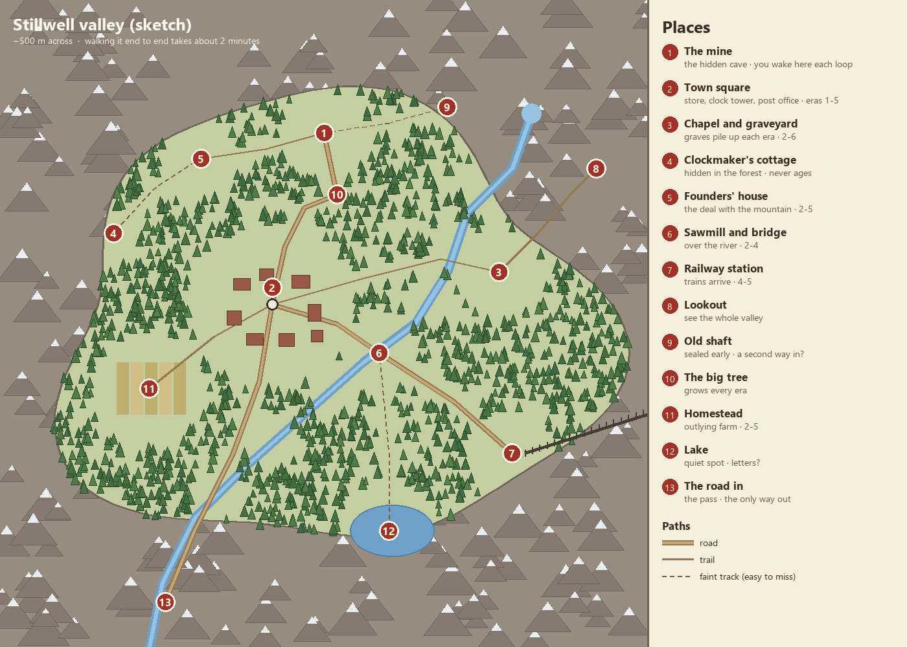
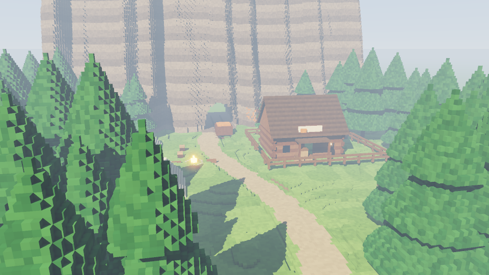
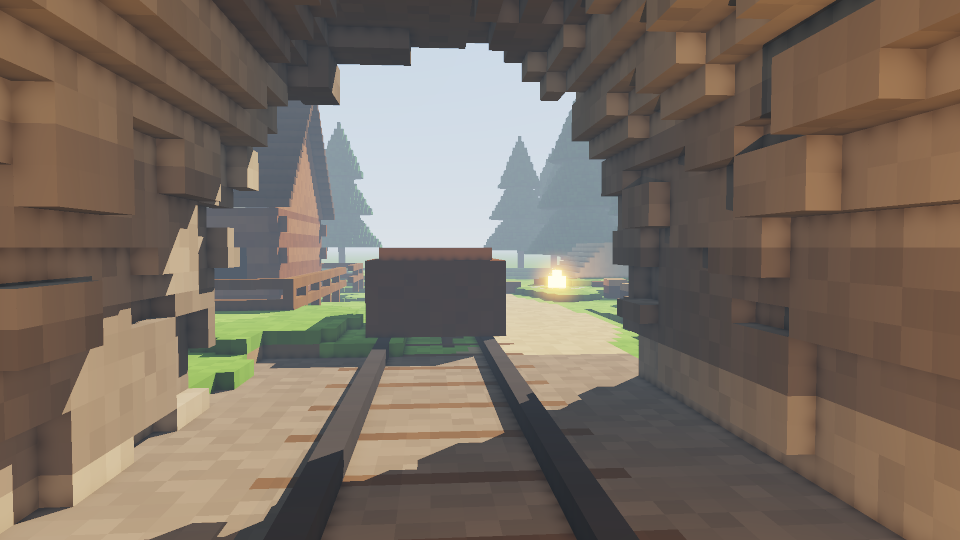
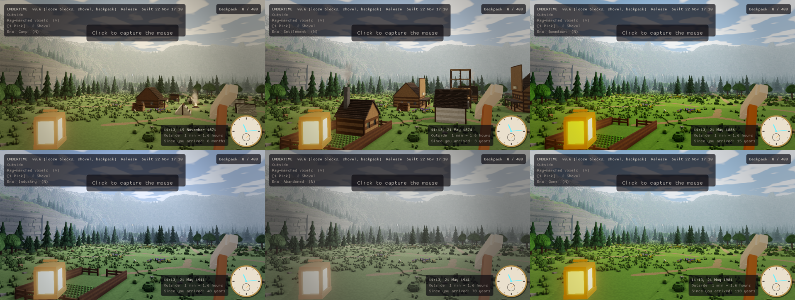

# UNDERTIME design

What has been decided for UNDERTIME and why, as of 2026-11-24. Items are marked:
- **Decided**: the user's decision.
- **Proposed**: an option on the table, not decided.
- **Open**: a question that needs the user's answer.

**Other documents:**
- `Status.md`: what's built, what's tested, branches and commits.
- `Changelog.md`: how each milestone was built, measurements, fixes after the user's looks.
- `NPCs.md`: people, dialog, missions, lives.
- `Hauling.md`: money, shops, the barrow, the claim, food, wood, farming, machines.

The images in `Images/` are sketches made with standalone renderers (not CherryEngine). They show layout, mood and colour, not final quality. The four era images (`era_*.png`) were drawn before the switch to the all-voxel style, so use them for layout and mood only.

---

## 1. The pitch

You are a courier who has come to a valley that's on no map. You find a hidden cave and a mining town called **Stillwell** (placeholder name). You mine the mountain and sell what you find in town. The deeper you dig, the faster time runs outside: the town grows, booms, decays and finally disappears. Time crystal from the deep rock lets you wind the valley's clock back, so nothing you've built or earned is ever lost (section 3). The goal is to find the 16 Strange watches and reach the heart of the mountain.

The title is literal: you work **under** while time runs **over**.

**The feeling to aim for:** every dive is a bet. Deeper rock pays more and costs the town years, and you come up not quite knowing what you'll find.

---

## 2. The core rule: time runs faster the deeper you are

| Where | 1 real minute = | Cost of a 10-minute dive |
|---|---|---|
| Surface | about 1.6 hours (a day takes 15 minutes) | — |
| Zone 1 | 8 hours | a few days |
| Zone 2 | 1 day | a week and a half |
| Zone 3 | 1 week | a season |
| Zone 4 | 1 month | almost a year |
| Zone 5 | 1 year | a decade |

- **Decided:** the rate rises through the entrance passage and steps up at each zone. All rates are in `Config.h` (`kZoneRate`) and will be tuned in play.
- **Decided:** the richer ore is deeper (copper from the top, then silver, then gold, then Time crystal from about 64% depth), so every dive trades value for time.
- **Open:** the steps between zones are uneven (×3, ×7, ×4, ×12). Is the big jump into zone 5 deliberate (the last zone as a real decision), or should the steps be smoothed?

### What fast time does
- **The surface changes** through the eras (section 4). Built.
- **You can see it from inside:** daylight at the mouth and down the shafts follows the outside clock; clouds race; faint time-lapse figures cross the mouth. Built.
- **The HUD watch** has two dials: your own time, and outside time spinning. It warns you before an era change. Built.
- **Coming up:** a short summary ("4 years, 2 months passed. Stillwell is now a Boomtown."). Built.
- **Friendships fade** while you're away (NPCs.md). Built.
- **Crops ripen and spoil, trees grow back, machines run** in outside time (Hauling.md). Built.
- **Proposed, not built:**
  - **Bills:** the company charges rent per outside day. Debt is **capped**: when you can't pay, it takes your gear back.
  - **Savings:** the bank pays interest per outside day and can **fail at an era change**, or the currency changes. "Money rots, ore doesn't." See section 3, "Rewind rules", for why this needs care.
  - **Prices drift** with outside time, so you check the board when you come up.
  - **Lantern fuel** burns in your own time, which limits a zone 5 dive to about a decade. Ways out (rope, lift) shorten the trip up.
- **Idea:** carrying Time crystal in the backpack raises the time rate.

### Day and night
- **One outside clock** (`Clock.h`): days since you arrived, advanced every frame by your real time × the rate where you are. It drives the time of day, the date, the weather, and the era. The season isn't used yet.
- **Outside:** the sun crosses the sky, low and warm at dawn and dusk; dim blue moonlight and stars at night; sky, fog and ambient keyed to the hour; shadows follow the sun.
- **Night in town:** windows and lamps light up at dusk, the campfire glows, and the era decides which lights exist.
- **No strobing:** when days pass faster than about one every 2 seconds, the light blends towards the day's average and only pulses gently. You feel time racing without a flashing screen.
- **Eras** advance from the clock (thresholds in section 4), only while the valley can't be seen, so nothing pops in.
- **Weather** comes from the clock too (`WeatherAt`), the same for the same day, so a rewind replays it.
- **Seasons** (not built): grass colour, falling leaves, snow on upward faces in winter, through shader globals, on top of the era grade.

### Danger and failure (Open)
Today nothing in the cave can hurt you. Hunger makes you weaker but never kills you (decided, Hauling.md). Without some risk, a deep dive is only a time tax. Questions:
- **Cave-ins:** do they hurt or trap you? **Proposed:** they knock you down and cost you own-time (you dig out), never kill you.
- **The lantern:** what happens when it runs out? **Proposed:** the cave goes dark except for crystals and daylight, and you find your way out by them.
- **Death:** is there any? **Proposed:** none. You wake at the mouth, and the time that passed while you were "out" is the cost.

---

## 3. One continuous game

**Decided (2026-11-22):** there are no runs and no reset. The player must never feel they lost progress. Instead, **the outside clock can be turned back with Time crystal** at the clockmaker. (The old run structure, dropped: each walk into Gone reset everything except crystal upgrades and watches, on a new cave seed.)

### Turning time back
- **Decided:**
  - **At the clockmaker:** spend Time crystal to wind the valley back by years.
  - **Why it fits the story:** the courier's watch already runs backwards near the mountain; that becomes the player's tool.
  - **What it's for:** going back to an era whose shop stock you need, catching an event you missed, or bringing the town back from Gone.
  - **Gone is not a game over:** it's a quiet forest era you can visit, and the clockmaker is still there.
  - **Time crystal is a choice:** sell it for money, or keep it to buy time back.
  - **The mountain is finite:** one cave for the whole game; mined rock stays mined.
- **Proposed:** you can't wind back past the day you arrived.
- **Open:** how much crystal a year costs, and whether it gets dearer the further back you go, or with each rewind.

**The design risk:** the pitch says your digging kills the town. If rewinds are cheap and keep everything, that has no weight, and neither does the ending's "save the town". A rewind needs a real cost besides crystal. Friendships going back is one (decided). **Proposed** options for more:
- **Un-met for good:** people you un-met keep a déjà vu but never become as close again.
- **The graveyard keeps its graves:** names of people from the undone years stay on the stones.
- **Rewinds get dearer each time**, not only with distance.

### Rewind rules
One table for what goes back and what stays.

| Thing | On a rewind | Status |
|---|---|---|
| The outside clock, era, date, season, weather | goes back | decided |
| The town (buildings, shop stock, who lives there) | goes back with the era | decided |
| Friendships, NPC memory | go back past the day you met; the clockmaker remembers | decided |
| Money, ore, tools, upgrades, the backpack | stay | decided |
| Strange watches found | stay | decided |
| The cave (mined rock, props, machines in it) | stays | decided |
| Machines on the surface | stay | decided |
| Your claim | stays, shielded by a machine (to be designed); time still moves forward there | decided |
| Missions | can be done again, and pay again | decided for now; the fallback is paying money once per game (NPCs.md) |
| Stone in the yard, town projects | **Open** | |
| Graves | **Open** (see above) | |
| Bank savings, rent paid | **Open** (what if you wind back past the bank's opening?) | |
| Prices | **Open** (go back exactly, or can rewinding be farmed?) | |

**Loops to check before building rewinds** (each one turns crystal into unlimited money if left open):
- Interest earned forward, then a rewind that keeps the money.
- Buy in a cheap era, rewind or dive, sell in a dear one.
- Missions paid again after each rewind.
- Crops and machines on the shielded claim producing across rewinds.

**Proposed:** allow the price loop (it's what "go back to the era you need" means) but cap it with the crystal cost, pay each mission's money once, and have the bank's savings go back with the clock.

### The loop
**Proposed** wording of what's built and decided, at three scales:
- **A swing:** time the swing, crack the rock, blocks fall; shovel them into the pack or barrow.
- **A dive (10–30 minutes):**
  1. Check the watch, the board and your claim.
  2. Pick a depth: shallow for safe stone, deep for ore and crystal at the cost of years.
  3. Mine, haul, set up drills and chutes.
  4. Come up to a changed valley: sell, order from the town, spend at the bench, eat, tend the claim, read the letters.
- **The game:** Camp → Settlement → Boomtown → Industry → Abandoned → Gone, the picks that open each sealed band, the 16 watches, the heart. Rewinds let you go back for what you missed.

### Progression
The gates, from what's built (`Economy.h`, `Config.h`):

| Gate | Opens | Costs | Era |
|---|---|---|---|
| Starting pick | zone 1 | — | Camp |
| Copper pick | the first sealed band, zone 2 | 800 + 40 copper, at the smith (Bram) | from Camp |
| Silver pick | the second band, zone 3 | 2,500 + 40 silver | from Camp |
| Gold-edged pick | the deepest bands, zones 4–5 | 8,000 + 30 gold | from Camp |
| Strange watches | the heart | 16 found, from 27% depth, 60% in sealed pockets | any |

- **Open:** every pick is for sale in the Camp era, so the eras don't gate the depth at all, only money and ore do. Should the silver and gold picks wait for later eras (Boomtown, Industry), so you have to let time pass to go deeper? That would tie the two halves of the game together.
- **Open:** does the gold pick open both of the last two bands, or should there be a fourth tier? Today one pick opens zones 4 and 5 together.
- **For scale:** the Camp era lasts 2 outside years. That's about 180 real hours on the surface, 36 hours in zone 1, 12 hours in zone 2, under 2 hours in zone 3. So the first era change effectively comes when the player first stays in zone 3, which is after the second pick.

### Economy model (Open)
No numbers yet beyond prices in `Economy.h`. A first model is needed before tuning:
- **Income per dive** by zone (stone, copper, silver, gold, crystal), against the costs (picks, food, orders, rent if it's built).
- **The crystal exchange rate:** crystal mined per real minute in zone 4–5, against crystal per rewound year. This number decides whether time is precious or free.
- **Target length:** how many hours of play, and how many dives, from arrival to the heart.

### Mined stone (decided 2026-11-22)
- **Nothing the player mines is ever lost.** No cap on loose blocks and no crumbling away; every block stays until the player moves, uses or sells it. (How: blocks settle into 1 m piles; `Changelog.md`.)
- **Stone sells from the start.** The Camp-era trading post already buys it.
- **Moving stone out of the mountain is a main activity**, so it needs plenty of purpose.
- **Better vehicles come with the eras.**

### Hauling, crafting, the claim, food and machines (decided 2026-11-23)
The full plan is in `Hauling.md`.
- **Carrying:** the backpack holds stone and ore, and its load doesn't slow you. A wheelbarrow, filled with the shovel, carries more and does slow you.
- **Selling stone:** you tip it in the trading post's yard. You're paid once per block, and the blocks stay there as the town's, a heap that town projects use up.
- **Crafting:** townspeople make things (the smith, the trading post, the store), and orders are instant. You make basic things at your own workbench. What can be ordered depends on who lives in the valley in that era.
- **Automation:** drill rigs, chutes, conveyors and an ore mill. Machines work in their own time, at the rate of where they stand.
- **Your claim:** a meadow east of the mine, away from town, built piece by piece with the hammer on a grid.
- **Hunger:** drains in your own time; running out makes you weaker, with no death.
- **Wood:** trees can be felled and grow back with outside time.
- **Farming:** on your claim, by outside days: crops ripen, stay ripe for a while, then spoil.
- **Open:** the clockmaker's governor (a part that holds a machine to your own time).
- **Proposed:**
  - **Vehicles by era:** Camp, a wheelbarrow; Settlement, a hand cart on wooden rails (built); Boomtown, mule-pulled ore carts and the winding tower; Industry, an electric tram and the lift; Abandoned, the rusted gear still works if you repair it.
  - **Stone prices by era:** high while the town builds its foundations (Camp, Settlement), falling once it builds in brick.
  - **Stone for building:** the claim's buildings, and packing mined-out rooms so the roof holds.
  - **The spoil heap:** stone tipped at the mine mouth makes a heap that grows all game, a progress meter you can see from town.

### Saving (Open, needed for "nothing is lost")
The save (`SaveGame.h`) keeps the clock, your position, the backpack, gear, hauling and the NPC log. **It doesn't keep the mined cave**: a load rebuilds the mountain unmined from its seed, so props and drills stand in rock, and loose blocks and piles are gone. That breaks "mined rock stays mined" and "no block is ever lost".
- **Proposed:** save the grid as a difference from its seed (only changed cells, compressed), plus the loose block records, piles, boulders and placed things. Measure the size after a long session.
- **Open:** one save slot or several?

### Controls
The player's keys (debug keys are in `CLAUDE.md`):

| Key | Does |
|---|---|
| 1 / 2 / 3 / 4 | pick / shovel / hammer / axe |
| Left mouse | use the tool |
| Right mouse (hammer) | place a piece; R turns it; X held takes down |
| E | use: talk, the barrow and cart, furniture, doors, plots, machines, the notice board, pick up |
| R | the pack's stone into the barrow |
| Q | tip the barrow or cart |
| B | what the shovel fills |
| F | eat |
| Tab | the journal |
| C (title screen) | continue |

- **Open:** R does two things (turning a hammer piece, emptying the pack into the barrow), and E does many. Context decides today; the rule should be that the hammer in hand owns R.
- **Comfort:** no strobing is decided; camera shake on cave-ins should get a setting.

---

## 4. Eras

Six stages: five to play, plus the end. The town booms on your ore, then decays as your digging speeds up time.

| # | Era | Outside time since you arrived | Town | Mine entrance | At night | Built |
|---|---|---|---|---|---|---|
| 1 | **Camp** | 0–2 years | tents, a campfire, one trading post | bare cave mouth | campfire | yes |
| 2 | **Settlement** | 2–10 | plank houses, the shops, clock tower being built | timber frame at the mouth | oil lamps in windows | yes |
| 3 | **Boomtown** | 10–30 | painted false fronts, bank, busy streets | rails, ore carts, a winding tower | lots of warm windows | no |
| 4 | **Industry** | 30–60 | brick, chimneys, the clock tower finished | an engine house, an electric light at the mouth | electric streetlights | no |
| 5 | **Abandoned** | 60–100 | boarded windows, collapsed roofs, weeds | rusted and fenced off | one lit window: the last shopkeeper | no |
| — | **Gone** | 100+ | forest over grassy mounds, the clock face in the grass | the cave mouth, bare again | darkness | no |

- **Decided:** era changes happen only while the valley can't be seen (deep in, or inside and facing away from the mouth).
- **Decided:** each era opens and closes places and shop stock, so you sometimes dive deep on purpose to reach the era that sells what you need. What each shop sells per era is in `Economy.h`, not here.
- **Seasons** follow the outside clock. Coming out to snow after a summer descent is the cheapest way to feel lost time.
- **Industry with no railway:** the valley is cut off, so power has to come from the valley itself. **Proposed:** a power house on the river.

Images: `era_1_camp.png`, `era_2_boomtown.png`, `era_3_abandoned.png`, `era_4_gone.png` (layout and mood only).

---

## 5. Story

**Decided:**
- **The courier** is delivering a letter to a town that's on no map. Near the mountain, their pocket watch runs backwards.
- **The town was founded on borrowed time:** the founders made a deal with the mountain, long rich lives in exchange for leaving the Time crystal in the rock. Mining breaks the deal, and that's why time speeds up.
- **16 Strange watches** belong to miners who went too deep. Each has an engraving that tells part of the story.
- **The game is more or less done when you've found all 16 watches.** There's no deadline.
- **The clockmaker** sells the permanent upgrades, winds time back, never ages and remembers you across rewinds. The biggest mystery in the valley.
- **The graveyard** fills up across the eras with names of people you met (built).

**Open, needing new versions since the loop was dropped:**
- **The twist:** "the courier started the loop themselves" no longer fits.
- **Why you stay:** the pass at the south end is blocked; the fog that brought you back to the cave belonged to the loop. **Proposed:** the letter you carry is addressed to someone who hasn't been born yet, so you wait (and dive) to deliver it.
- **Why time speeds up from zone 1 on day one**, if the deal only breaks as you mine. **Proposed:** the deal was already breaking (the founders' miners went too deep); you're the one who finishes it.

### The watches and the heart
- **Built:** 16 watches are placed by the cave generator from 27% depth, 60% of them in sealed pockets (`kWatchCount`, `kWatchMinDepth`, `kWatchInPocketChance`).
- **Proposed:** the 16 watches open the heart, a huge Time crystal at the far wall, and the ending choice stays: **take the heart** (free yourself, and time stops speeding up, but the town is lost for good) or **leave it** (save the town, and stay).
- **Open:**
  - How the player learns where watches are: engravings pointing to the next, the saloon's rumours, letters, missions.
  - How many per zone. Today they're spread by depth, so a player could find most of them without reaching zone 4.
  - What each ending shows, and whether play goes on after it.
  - How 100 years plays out: a last letter, a descendant.

### NPCs
The full design is in `NPCs.md`: each NPC's state is computed from the outside clock plus a log of what the player did, so dives and rewinds need no frame-by-frame simulation.

**Decided (2026-11-23):**
- **No randomly generated NPCs.** Every NPC is written by hand with their own story; each era's population is the written cast.
- **Placeholders for now** (looks and stories); hand-made models in MagicaVoxel later, one per character.
- **The clock pauses during a conversation.**
- **Friendships fade** while you're away, and go back with rewinds.
- **The notice board** has generated jobs, each posted by a written NPC.
- **Also in:** déjà vu for NPCs from a timeline you undid; faint time-lapse figures seen from the mine while time races; letters waiting when you come up; weddings, funerals and festivals on fixed dates.

**Open:** each resident's story and how it changes per era.

---

## 6. The valley and the town

- **Size:** about 500 m across, about 2 minutes to walk. Ringed by mountains, with deep forest between the places.
- **Not linear:** places are spread out, and you explore to find them. You navigate by sight (clock tower, smoke, lit windows) instead of a minimap. **Idea:** the lookout puts the valley map in your journal.
- **Paths:** roads, trails, and faint tracks that are easy to miss.
- **No railway:** the valley is cut off. (The map image still shows a station, which has been removed.)

| # | Place | Purpose | Eras |
|---|---|---|---|
| 1 | The mine (hidden cave) | where you arrive | all |
| 2 | Town square | the shops and the clock tower | 1–5 |
| 3 | Chapel and graveyard | graves pile up | 2–6 |
| 4 | Clockmaker's cottage | upgrades, rewinds; never ages; easy to find, by a footbridge with a water wheel on the river east of the square | all |
| 5 | Founders' house | the deal with the mountain | 2–5 |
| 6 | Sawmill and bridge | grows with the town | 2–4 |
| 7 | Lookout | view of the whole valley | all |
| 8 | Old shaft | sealed early; maybe a second way in | ? |
| 9 | The big tree | grows every era (a clock anyone can read) | all |
| 10 | Homestead | outlying farm | 2–5 |
| 11 | Lake | quiet spot | all |
| 12 | The road in | the blocked pass | all |
| 13 | Your claim | a meadow east of the mine | all |

### Town plan

- **Every building has its own plot:** a fence with gates, and a garden or yard that tells you who lives there.
- **Several routes between places:** roads, lanes, and shortcut footpaths (a back alley, stepping stones, a path through the orchard, a footbridge).
- The main shops share a small square. Everything else is spread out.

| # | Building | Purpose |
|---|---|---|
| 1 | Trading post | buys stone (the yard) and ore from the Camp era on |
| 2 | Assay office | sells ore; on the mine road |
| 3 | General store | oil, rope, the bag |
| 4 | Bank | savings and interest; Boomtown to Industry (not built) |
| 5 | Post office | letters (built), courier missions |
| 6 | Saloon and inn | rumours, hints about watches, the notice board |
| 7 | Blacksmith | picks and repairs |
| 8 | Clockmaker | Time crystal upgrades, rewinds |
| 9 | Chapel and graveyard | story |
| 10 | Founders' house | story |
| 11–15 | Homes: the widow, the family, the doctor, the teacher, the boatman | residents whose stories run across the eras |
| 16 | Sawmill | Settlement to Industry |

**Idea:** fences age with the eras. Broken fences open shortcuts and overgrown hedges block old ones.

---

## 7. Visual style

### One blocky style everywhere
- **Everything is made of 0.25 m voxels** with flat colour per block (no texture detail), slight brightness variation per block, and strong corner shading.
- **The cave is real voxels** (ray-marched and diggable).
- **Everything outside is designed as blocks** and **baked into meshes** at load, drawn coarser with distance.
- **Only mountain rock is diggable.** Swinging the pick at built things gives a "hollow hit" bounce.
- **The cave mouth is seamless:** the same blocks and palette continue from the valley into the mountain. The face is craggy ledges with grass, an unbreakable 1 m skin, and a rough rock portal about 3 m wide; the Settlement adds a timber frame.

### Colours carry meaning
- **Warm amber:** people and the present (lantern, town, timber).
- **Cyan:** time (Time crystal, the watch's outside dial, the daylight flickering at the cave mouth).
- **Violet:** the stopped moment at the far wall.

### The cave
| Zone | Stone | What you see |
|---|---|---|
| 1 | warm ochre | timber frames, lamps, rubble |
| 2 | rust brown | old shoring |
| 3 | grey-green | collapsed timber |
| 4 | deep blue | no human traces, big crystals |
| 5 | violet | dust frozen in the air |

- **Lantern-lit darkness:** cave ambient stays very low, so the lantern does nearly all the lighting.
- **Depth cues:** strong corner shading, horizontal strata bands ("layers of time"), lamps along tunnels, timber, rubble, dust in the air, shadows and bloom.
- **Time crystal** glows cyan and is the only cold light.
- **Daylight** spreads in from the mouth and three natural shafts (into zones 1–3), fading around corners; from deep inside the mouth stays a bright spot. Shafts are fixed landmarks with a moving sun patch and dust in the beam.
- **Rock with metal in it:** ore is seams of metal in pixel clusters across blocks, cracks are pixel lines that run across blocks, and shading-only relief brings the walls to life under the lantern.
- **Not built:** timber props, wet rock by water (the cave has no water yet).

### Outside
- Day/night, weather, and later seasons follow the outside clock.
- Each era changes how places look, mostly by changing materials and their condition, not by building new models.

| Era | Materials | Shape | Colours | Light | Grade |
|---|---|---|---|---|---|
| Camp | canvas, raw logs | low, scattered | natural browns, cream canvas | campfire, lantern | warm sepia |
| Settlement | raw planks, shingle | one street forming | warm wood, some whitewash | oil lamps | warm |
| Boomtown | painted planks, false fronts, porches | tall fronts, winding tower | red, ochre, teal, cream | many warm windows | rich |
| Industry | brick, tin roofs, chimneys | bigger, two floors, smoke | brick red, soot, faded paint | electric streetlights | cold |
| Abandoned | ruined brick, boarded windows | broken outlines, leaning | faded grey-brown, rust, weeds | one window | faded |
| Gone | nature only | mounds, clock face, giant tree | season colours, snow | none | green |

- **Colour grade per era:** "faded photograph" looks (`cfg::kEraGrades`); the cave has its own neutral grade. The first tuned values are kept in `Changelog.md`.
- **Against the flat look:** a low warm sun, a strong sun against a weak sky, SSAO, cloud shadows, height haze, light shafts, swaying foliage, ground cover, edge highlights. All built.
- **The mountain matches its face:** steep ground climbs in layers of rock risers and grass ledges, banded in three rock shades; crags break up long slopes.
- **Houses:** interiors with furniture and a lamp, glass windows that glow at night, rooms where the sky light drops. Not built: doors that open, upstairs floors.
- **People:** voxel puppets (one `.vox` per body part, animated in code), placeholders until the hand-made models.

### Asset kit (as voxel models)
| Kit | Pieces |
|---|---|
| Building shells | walls, corners, doors, windows, floors, foundations, in logs, raw planks, painted planks, brick, and ruined brick |
| Roofs | canvas, shingle, tin, collapsed |
| Fronts and add-ons | false front, sign board, porch, chimney, balcony, awning |
| Windows and doors | dark, lit (emissive), broken, boarded |
| Mine | cave mouth timbers, winding tower, rails, ore cart, fence |
| Nature | conifers (3 sizes), broadleaf, the big tree (one per era), stump, sapling, rocks, weeds, snow mounds |
| Clutter | crates, barrels, fences, washing line, lamp posts (oil and electric), wheelbarrow |

---

## 8. Technical plan

### Voxel art pipeline
- **Tool:** MagicaVoxel now, and maybe a voxel designer in the CherryEngine editor later (editing a live voxel volume, saving `.vox`, rebaking). `.vox` stays the format for both.
- **Placeholders:** the `UndertimePlaceholders` tool writes real `.vox` files into `Content/Models/`, so they can be opened and improved in MagicaVoxel.

### Engine additions
**Decided:** the user allows engine additions the visual style needs, like those below. Every one so far is built:

| Addition | Why |
|---|---|
| Voxel models (`.vox` load and save, mesh and collision baking, the asset type) | everything outside is voxel models |
| Sky, global shader inputs, nearest-8 point lights, instancing | night, sway, snow; the forest |
| Sun shadows (meshes and voxels), bloom, FXAA | the biggest gain outside; glowing windows and crystals |
| Interior box, light volume, rooms, glass | the cave lit per pixel; daylight in the cave; houses |
| SSAO, cloud shadows, light shafts, height fog, edge highlights | depth and air |
| Colour grade, eye adaptation | the era looks; coming out of the cave |
| Particles (with stretched streaks) | dust, smoke, sparks, rain |
| Dithered crossfade, compact meshes | the valley LOD |

**Proposed, not built:**
- Clustered or tiled lights, so house lamps can be real lights (more than 8 point lights).
- Soft particles.
- Screen-space reflections (windows and moonlight in the river).

### Milestones
Each one must build and run. Done so far (details in `Changelog.md`, test state in `Status.md`):

1. Voxel model pipeline
2. Engine visuals I
3. The valley
4. Engine visuals II
5. Camp era
6. Settlement era
7. Fixes (loose-block slowdown, voxel shadows, anti-aliasing, the cave mouth)
8. The outside clock and day/night
9. Light and depth
10. The mountain matches its face
11. Houses
12. Particles
13. Visual polish II (light shafts, foliage, era grade, eye adaptation, water, edge highlights)
14. Visual polish III (haze, mining feel, the cave comes alive, weather)
15. Valley LOD
- NPC milestones 1–5 (`NPCs.md` §10) and hauling H1–H12 (`Hauling.md`).

**Proposed next, in this order (Open: the user picks):**
1. **Playtest:** play everything untested, answering the questions in section 10. No new features.
2. **Saving the mined cave** (section 3, "Saving").
3. **Turning time back,** with the rewind rules decided (section 3).
4. **The watches and the heart** (section 5), to give the game an end.
5. **Danger** (section 2).
6. **The Boomtown era** (town, cast, shops, mule carts).
7. Then: Industry, Abandoned and Gone; seasons; animals and places of interest.

---

## 9. Parked and open

- **Seasons:** promised (section 2, section 4, the grade can take a tint), not scheduled.
- **Dropping into a shaft:** should a natural shaft, or the old shaft, be a way into the cave (rope, ladder)?
- **Places of interest** every 40–60 m: a fishing dock, a hunter's hut, a lookout tower, a quarry, a lumber camp, an orchard, ruins, a beaver dam, each maybe holding a journal page or a watch clue.
- **Animals:** deer, birds, chickens, jumping fish, fireflies.
- **Night life:** fireflies, moonlight glinting on water, lit windows reflected in the river.
- **Things to do:** time investments (plant saplings, commission the smith, bury a time capsule, leave a letter for an NPC's grandchild, then collect after a dive); gold panning in the river (Camp-era income); fishing and foraging; collections at the assay office; festivals on dates you aim to surface for; casks that age on the claim; animals on the claim.
- **Timber supports** that hold the roof up against cave-ins (wood is built; supports as props partly exist through `held`).
- **Not built yet, small:** doors that open, upstairs floors (the Saloon's and the Founders' House's upper windows have nothing behind them), house lamps as real lights, soft particles.
- **The `.vox` designer in the editor.**
- **Audio:** out of scope for now, but time racing (a rising hum, a ticking that speeds up) would carry much of the feeling. Plan for it.
- **Tuning:** time rates, era thresholds and prices, all in play.

---

## 10. Playtest questions

For the first long session over everything untested (milestones 8–15, NPCs, hauling):

- **The time rule:** does a dive feel like a bet? Do you check the watch? Does coming up surprise you?
- **The first era change:** when does it come, and does it read (the summary, the town, the grade)?
- **The first hour:** do you understand the time rule without being told?
- **Hauling:** is moving stone fun or a chore? How many trips before it's tiresome? Does the barrow's slowdown feel fair?
- **The claim:** do you want to come back to it between dives?
- **People:** do you remember who anyone is? Do the letters and news land?
- **Hunger:** does it add anything, or only interrupt?
- **The look:** eye adaptation coming out; light shafts; the LOD pop-in with each preset; weather.
- **Speed:** frame time in the valley and in a big pile; load time.

---

## 11. The first complete slice

So the later eras don't block a game that can be played to the end. **Proposed:**
- Camp and Settlement only (built), plus the Boomtown if it's ready.
- Zones 1–3 and the picks for them.
- About 6 of the watches placed in those zones, the clockmaker's rewind, and a temporary ending at the third zone's far wall.
- Saving the mined cave.
- The clock capped so the valley can't pass the Boomtown in this slice.

Done when someone who hasn't seen it can play from the arrival to that ending without help.
