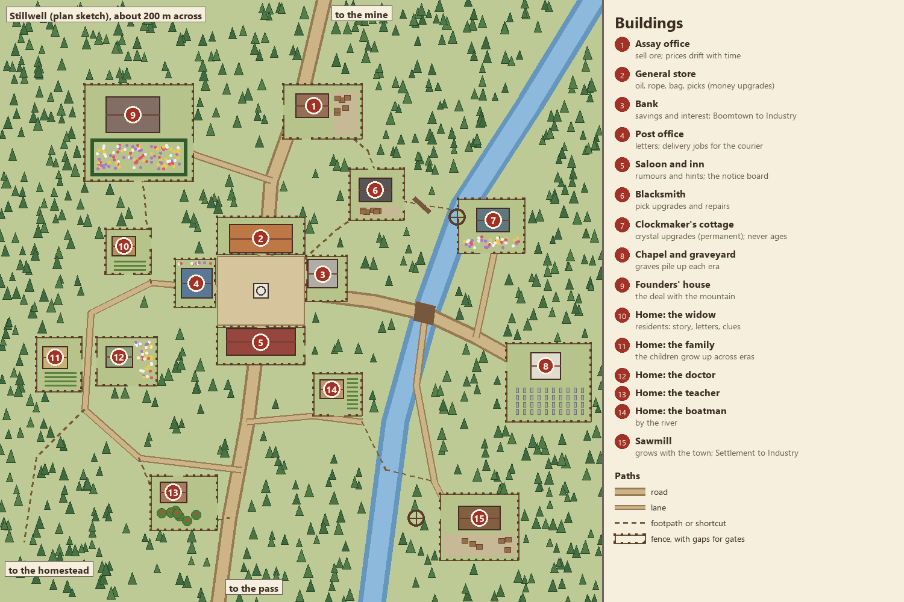
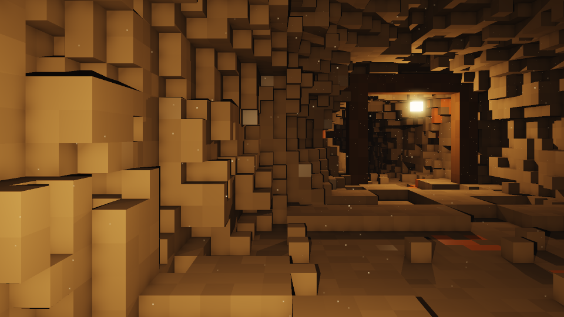

# UNDERTIME design

What has been decided for UNDERTIME, as of 2026-11-22. Sections marked **Open** or **Idea** are not decided yet.

## Where it stands (2026-11-22)

- **Playable now:**
  - **The cave game:** mining, cave-ins, boulders, loose blocks, shovel, backpack.
  - **The valley:** river, lake, forest, mountains in rock strata.
  - **The town:** the Camp and Settlement eras, with furnished houses and glass windows.
  - **The cave mouth:** a craggy rock face that matches the mountain, with a rough rock portal.
  - **Time:** the outside clock (time faster with depth), day and night, the HUD watch, and eras that change by themselves.
  - **Light:** daylight reaching into the cave from the mouth and from three natural shafts, clouds and their shadows, SSAO.
  - **Particles:** smoke, sparks and dust.
- **Committed:** milestones 1–12 are on the branch `features/voxel-town` (pushed). The fixes after milestone 12 (clouds) aren't committed yet.
- **Not tested by the user yet:** milestones 8–12 (the list is in section 8, under each milestone).
- **Not built yet:**
  - the shops and the economy;
  - turning time back at the clockmaker (section 3);
  - the story (letters, watches, NPCs);
  - the heart and the ending;
  - the Boomtown, Industry, Abandoned and Gone eras;
  - seasons;
  - the valley coming alive (people and animals);
  - activities.
- **Next:** the visual polish proposed in section 8 ("Visual polish, proposed"), then the game systems (shops, story; runs were dropped), in an order to be decided.

The images in `Images/` are sketches made with standalone renderers (not CherryEngine). They show layout, mood and colour, not final quality. The four era images (`era_*.png`) were drawn before the switch to the all-voxel style, so use them for layout and mood only.

---

## 1. The pitch

You are a courier who has come to a valley that's on no map. You find a hidden cave and a mining town called **Stillwell** (placeholder name). You mine the mountain and sell what you find in town. The deeper you dig, the faster time runs outside: the town grows, booms, decays and finally disappears. Time crystal from the deep rock lets you wind the valley's clock back, so nothing you've built or earned is ever lost (section 3). The goal is to reach the heart of the mountain.

The title is literal: you work **under** while time runs **over**.

---

## 2. The core rule: time runs faster the deeper you are

| Cave zone | 1 minute underground = | Cost of a dive |
|---|---|---|
| 1 | 8 hours outside | almost nothing |
| 2 | 1 day | a week |
| 3 | 1 week | a season |
| 4 | 1 month | years |
| 5 | 1 year | decades |

- The richer ore is deeper (copper from the top, silver, then gold, then Time crystal from about 64% depth), so every dive trades value for time.
- All ratios are tuning numbers in `Config.h`. These are starting values.
- Outside, time runs at a normal-feeling pace: **a day takes 15 minutes** (1 minute = about 1.6 hours). Zone 1 is 5 times that, so even the first zone is faster than the surface. (Zone 1 was "1 hour" before, which was slower than the surface.)
- The rate follows how far in you are: it rises through the entrance passage and steps up at each zone.

### What fast time does
- **Bills:** the company charges rent per outside day. Debt is **capped**: when you can't pay, it takes your gear back. It can't grow forever.
- **Savings:** money in the bank earns interest per outside day. The bank can **fail at an era change**, or the currency changes. "Money rots, ore doesn't."
- **Prices drift** with outside time, so you check the board when you come up.
- **The surface changes** through the eras (section 4).
- **You can see it from inside:** daylight at the cave mouth flickers between day and night faster the deeper you are.
- **The HUD watch** has two dials: your own time, and outside time spinning.
- **Limits on long stays:** lantern fuel burns in *your* time, so a zone 5 dive costs about a decade at most. The watch warns you before an era change. Ways out (rope, lift) shorten the trip up.
- **Idea:** carrying Time crystal in the backpack raises the time ratio.

### Day and night
Planned for milestone 8 (the outside clock).
- **One outside clock** (game code): days since you arrived, advanced every frame by your real time × the rate where you are. It drives the time of day, the date and season, and the era.
- **Time of day outside:**
  - The sun crosses the sky, low and warm at dawn and dusk.
  - A dim, blue moonlight at night; stars in the sky.
  - Sky, fog and ambient colours keyed to the hour.
  - Shadows follow the sun.
- **Night in town:** windows and lamps light up at dusk (a shader global for "night"), the campfire glows, and the era decides which lights exist.
- **Seen from the cave:** the daylight reaching in from the mouth and the shafts follows the outside clock.
  - **No strobing:** deep down, days pass faster than once per second, so when cycles get faster than about one every 2 seconds the light blends towards their average and only pulses gently. You feel time racing without a flashing screen.
- **The HUD watch:** UI only (drawn with the rest of the HUD; no watch model in the player's hand). Two dials, your own time and the outside time, plus the date. It warns you before an era change.
- **Coming up:** a short summary ("4 years, 2 months passed. Stillwell is now a Boomtown.").
- **Eras** advance from the clock (the thresholds in section 4), only while the valley can't be seen, so nothing pops in. N stays as a debug key.
- **Seasons** (later in the same milestone, or the next): grass colour, falling leaves, snow on upward faces in winter, all through shader globals.
- **Debug:** a key that skips ahead by hours, and `UNDERTIME_DEV_TIME` to start at a given hour.

---

## 3. One continuous game, and turning time back

**Decided (2026-11-22, the user's decision):** there are no runs and no reset. The player must never feel they lost progress. Instead, **the outside clock can be turned back with Time crystal** (Claude's proposal, chosen by the user).

### Turning time back (decided)
- **At the clockmaker:** spend Time crystal to wind the valley back by years.
- **What goes back:** only the outside clock, and so the town's era, the date and season.
- **What stays:** your money, ore, tools and upgrades, the Strange watches you've found, and your claim.
- **Why it fits the story:** the courier's watch already runs backwards near the mountain. That becomes the player's tool instead of a cutscene.
- **What it's for:** going back to an era whose shop stock you need, catching an event you missed, or bringing the town back from Gone.
- **Gone is not a game over:** it's a quiet forest era you can visit. The clockmaker is still there, so you can wind back from it whenever you like.
- **Time crystal is a choice:** sell it for money, or keep it to buy time back.
- Rock still gets harder with depth, and the sealed bands between zones still need better picks.

### Also decided (2026-11-22)
- **Friendships go back with time:** wind back past the day you met someone and they don't know you any more. Rewinding has a real cost in people, not only crystal.
- **The claim is shielded from rewinds:** your own plot has a machine (to be designed) that keeps winding time back from touching it. Time still moves forward there while you're in the cave, so what you leave there grows and ages.
- **The mountain is finite:** one cave for the whole game, and nothing grows back. Mined rock stays mined.
- **The game is more or less done when you've found all 16 Strange watches.** There's no deadline.

### Proposed, not decided yet
- **The heart:** the 16 watches still open it, and the ending choice stays.
- **The floor:** you can't wind back past the day you arrived.

### Open
- **The cost:** how much Time crystal a year costs, and whether it gets dearer the further back you go.
- **Things you leave outside:** savings in the bank (what if you wind back past the bank's opening?), rent already paid.
- **Story:** the courier's twist ("started the loop themselves") and the fog at the pass both came from the loop; they need new versions.
- **The shops' memory:** do prices and stock go back exactly, or can rewinding be farmed for money?

### Mined stone (decided 2026-11-22)
- **Nothing the player mines is ever lost.** No cap on loose blocks and no crumbling away; every block stays until the player moves, uses or sells it.
- **Stone sells from the start.** The Camp-era trading post already buys it.
- **Carts move it.** Moving stone out of the mountain is a main activity, so it needs plenty of purpose.
- **Better vehicles come with the eras.**

**Built (2026-11-22, not yet tested by the user): no block is ever lost.**
- **Settling:** a block that stays put for half a second (jitter in a heap counts as staying put) settles into the pile of its 1 m cell: one mesh and one static body per cell. A pile collects settling blocks for 0.3 s and is then rebuilt with all of them, within 2 ms a frame.
- **Waking:** mining under or beside a pile wakes those blocks, and whatever rests on them, so they fall again.
- **Limits:** only blocks in motion have their own body (at most 2,500 at once; past that the stillest settle early). A block that falls out of the world is put back at the mine mouth.
- **Numbers:** in Release, 8,000 blocks thrown out with a random push and spin all settled into 180 piles within about 4 s, with physics at 0.03 ms a frame afterwards. Rebuilding a pile of 64 blocks takes about 1.3 ms.
- **Fixed after the user's first test (2026-11-22):** blocks only settled once the physics put them to sleep, and a heap you're mining on rarely sleeps (3,500 blocks stayed live, physics 20 ms). Each pile rebuild also cost about 7 ms, because the engine waited for the GPU on every upload. Now blocks settle by staying put, and engine uploads no longer wait.
- **Test flags,** in the editor's Game panel, "Loose block tests":
  - the old cap: past 3,000 the oldest crumble away;
  - piles on or off;
  - **solid blocks:** falling blocks block the player;
  - **solid piles:** you have to shovel your way through.

  There are also buttons that drop 2,000 or 10,000 test blocks.

**Proposed, not decided:**
- **Vehicles by era:**
  - Camp: a wheelbarrow you push.
  - Settlement: a hand cart on wooden rails you lay yourself, which rolls down to the mouth.
  - Boomtown: coupled ore carts pulled by a mule, and the winding tower.
  - Industry: an electric tram and the lift.
  - Abandoned: the rusted gear still works if you repair it.
- **What stone is for:**
  - **Selling:** its price drifts by era. It's high while the town builds its foundations (Camp, Settlement) and falls once the town builds in brick.
  - **Town projects:** they need it by the thousand.
  - **Building:** for the claim's buildings, and for packing mined-out rooms so the roof holds.
  - **The spoil heap:** stone tipped at the mine mouth makes a heap that grows all game, a progress meter you can see from town.

### The old run structure (dropped, for reference)
Wake at the cave mouth on the arrival day; mine, sell and upgrade; walking into Gone reset everything except upgrades bought with Time crystal, unsold crystal and found watches; the cave got a new seed every run.

---

## 4. Eras

Six stages: five to play, plus the end. The town booms on your ore, then decays as your digging speeds up time.

| # | Era | Outside time since you arrived | Town | Mine entrance | At night | Shop sells |
|---|---|---|---|---|---|---|
| 1 | **Camp** | 0–2 years | tents, a campfire, one trading post | bare cave mouth | campfire | basic pick, lantern oil |
| 2 | **Settlement** | 2–10 | plank houses, the shops, clock tower being built | timber frame at the mouth | oil lamps in windows | bigger bag, rope |
| 3 | **Boomtown** | 10–30 | painted false fronts, bank, busy streets | rails, ore carts, a winding tower | lots of warm windows | better picks, dynamite; the bank opens |
| 4 | **Industry** | 30–60 | brick, chimneys, the clock tower finished | an engine house, an electric light at the mouth | electric streetlights | electric lamp, a lift in the mine |
| 5 | **Abandoned** | 60–100 | boarded windows, collapsed roofs, weeds | rusted and fenced off | one lit window: the last shopkeeper | leftover stock, high prices, a few rare items |
| — | **Gone** | 100+ | forest over grassy mounds, the clock face in the grass | the cave mouth, bare again | darkness | nothing; the clockmaker can wind time back |

- Era changes happen **only while you're underground**, so nothing pops in while you're looking.
- **Seasons** follow the outside clock. Coming out to snow after a summer descent is the cheapest way to feel lost time.
- **Industry with no railway:** the valley is cut off, so power has to come from the valley itself. **Proposal:** a power house on the river.
- Each era opens and closes places and shop stock, so you sometimes dive deep on purpose to reach the era that sells what you need.

Images: `era_1_camp.png`, `era_2_boomtown.png`, `era_3_abandoned.png`, `era_4_gone.png` (layout and mood only; the style is now voxel).

---

## 5. Story

**Decided (Claude's recommendation, chosen by the user):**
- **The courier** is delivering a letter to a town that's on no map. Near the mountain, their pocket watch runs backwards. Twist: they started the loop themselves on an earlier visit. (**Open:** this needs a new version now that there's no loop.)
- **The town was founded on borrowed time:** the founders made a deal with the mountain, long rich lives in exchange for leaving the Time crystal in the rock. Mining breaks the deal, and that's why time speeds up.
- **16 Strange watches** belong to miners who went too deep. They're keys to the **heart**, a huge Time crystal at the far wall. Each watch has an engraving that tells part of the story.
- **The ending choice:** take the heart (free yourself) or leave it (save the town).
- **The valley is cut off.** The pass at the south end is blocked; you can't leave. Walking up the pass could end in fog that brings you back to the cave. (**Open:** what keeps you here now that there's no loop.)
- **The clockmaker** sells the permanent upgrades and never ages, in any era. It's the biggest mystery in the valley.
- **The graveyard** fills up across the eras with names of people you met.

**Open:** a story for each resident and how each one changes per era (to be written later). Letters at era changes. How 100 years plays out, for example a last letter or a descendant.

### NPCs
The full proposal is in `Docs/NPCs.md`: each NPC's state is computed from the outside clock plus a log of what the player did, so dives and rewinds need no frame-by-frame simulation. It covers lives, schedules, personality, regard, dialog and missions.

**Decided (2026-11-23, the user's decisions):**
- **No randomly generated NPCs.** Every NPC is written by hand with their own story; each era's population is the written cast.
- **Placeholders for now** (looks and stories); they'll need much more detail later.
- **Mission rewards can be earned again** after turning time back (for now).
- **The clock pauses during a conversation.**
- **Friendships fade** while you're away.
- **The clockmaker remembers you** across rewinds, the only one who does.
- **The first cast** (placeholders): the Camp trading post keeper, the clockmaker and two or three campers, then the Settlement shopkeepers.
- **The notice board stays,** with generated jobs, each posted by a written NPC.
- **A save game** is built with the NPCs (their milestone 2).
- **Hand-made models** in MagicaVoxel for the final look, one per character.
- **Also in:** déjà vu for NPCs from a timeline you undid; faint time-lapse figures seen from the mine while time races; letters waiting when you come up; weddings, funerals and festivals on fixed dates.

---

## 6. The valley and the town

- **Size:** about 500 m across, about 2 minutes to walk (confirmed). Ringed by mountains, with deep forest between the places.
- **Not linear:** places are spread out, and you explore to find them. You navigate by sight (clock tower, smoke, lit windows) instead of a minimap. **Idea:** the lookout puts the valley map in your journal.
- **Paths:** roads, trails, and faint tracks that are easy to miss.
- **No railway:** the valley is cut off.

| # | Place | Purpose | Eras |
|---|---|---|---|
| 1 | The mine (hidden cave) | where you arrive | all |
| 2 | Town square | the four shops and the clock tower | 1–5 |
| 3 | Chapel and graveyard | graves pile up | 2–6 |
| 4 | Clockmaker's cottage | Time crystal upgrades; never ages; **easy to find**, by a footbridge with a water wheel | all |
| 5 | Founders' house | the deal with the mountain | 2–5 |
| 6 | Sawmill and bridge | grows with the town | 2–4 |
| 8 | Lookout | view of the whole valley | all |
| 9 | Old shaft | sealed early; maybe a second way in | ? |
| 10 | The big tree | grows every era (a clock anyone can read) | all |
| 11 | Homestead | outlying farm | 2–5 |
| 12 | Lake | quiet spot | all |
| 13 | The road in | the blocked pass | all |

(The valley map image still shows the railway station, number 7. It's been removed.)

### Town plan

- **Every building has its own plot:** a fence with gates, and a garden or yard that tells you who lives there (vegetable rows, orchard, ore yard, hedged formal garden).
- **Several routes between places:** roads, lanes, and shortcut footpaths (a back alley, stepping stones, a path through the orchard, a footbridge).
- The four shops share a small square (accepted for now). Everything else is spread out.

| # | Building | Purpose |
|---|---|---|
| 1 | Assay office | sell ore; prices drift. On the mine road. |
| 2 | General store | oil, rope, bag (money upgrades) |
| 3 | Bank | savings and interest; Boomtown to Industry |
| 4 | Post office | letters (the story); **idea:** delivery jobs for the courier |
| 5 | Saloon and inn | rumours, hints about watches, notice board |
| 6 | Blacksmith | pick upgrades and repairs (money) |
| 7 | Clockmaker | Time crystal upgrades (permanent) |
| 8 | Chapel and graveyard | story |
| 9 | Founders' house | story |
| 10–14 | Homes: the widow, the family, the doctor, the teacher, the boatman | residents whose stories run across the eras (to be written) |
| 15 | Sawmill | Settlement to Industry |

**Idea:** fences age with the eras. Broken fences open shortcuts and overgrown hedges block old ones.

---

## 7. Visual style

### One blocky style everywhere
- **Everything is made of 0.25 m voxels** with flat colour per block (no texture detail), slight brightness variation per block, and strong corner shading.
- **The cave is real voxels** (ray-marched and diggable).
- **Everything outside is designed as blocks** (terrain, buildings, fences, trees, props) and **baked into meshes** when the game loads, so it can use instancing and sun shadows. Far mountains may use 1 m blocks.
- **Only mountain rock is diggable.** Swinging the pick at built things gives the existing "hollow hit" bounce.
- The transition at the cave mouth is seamless: the same blocks and palette continue from the valley into the mountain.
- The cave grid's front is a craggy rock face with grassy ledges that continues the mountain around it. It can't be mined from outside: an unbreakable skin of rock about 1 m deep. The way in is a rough rock portal about 3 m wide; the Settlement era adds a timber frame around it.

### Colours carry meaning
- **Warm amber:** people and the present (lantern, town, timber).
- **Cyan:** time (Time crystal, the watch's outside dial, the daylight flickering at the cave mouth).
- **Violet:** the stopped moment at the far wall.

### The cave
| Zone | Stone | What you see |
|---|---|---|
| 1 | warm ochre | timber frames, lamps, rubble |
| 2 | rust brown | old shoring |
| 3 | grey-green | collapsed timber |
| 4 | deep blue | no human traces, big crystals |
| 5 | violet | dust frozen in the air |

- **Lantern-lit darkness:** cave ambient stays very low, so the lantern does nearly all the lighting.
- **Depth cues (approved):** strong corner shading, horizontal rock strata bands ("layers of time"), lamp props with point lights along tunnels, timber frames, rubble, tinted ambient fill, dust in the air, and later voxel shadows and bloom.
- Time crystal glows cyan (emissive) and is the only cold light.
- **Daylight from the mouth** (planned, milestone 9): skylight spreads in from the entrance through the tunnels, block by block, fading around corners. The first caverns are dim, deeper ones dark, and from deep inside the mouth stays visible as a bright spot (no black fog). It follows the outside clock.
- **Natural shafts** (planned, milestone 9): a few chimneys from the mountain top down into caverns of zones 1–3, maybe a rare one in zone 4. They let in daylight and a patch of sun that moves with the hour, with dust hanging in the beam: landmarks and resting spots. Their positions are fixed (they're part of the mountain, like the face), and the cave builds a cavern under each. From the mountain top they're holes in the ground. Open: can you climb or drop down one (a second way in, see "the old shaft")?

### Outside
- Day/night and seasons follow the outside clock: snow on upward faces, leaf and grass colours, sky colour.
- Each era changes how places look, mostly by changing materials and their condition, not by building new models.

| Era | Materials | Shape | Colours | Light |
|---|---|---|---|---|
| Camp | canvas, raw logs | low, scattered | natural browns, cream canvas | campfire, lantern |
| Settlement | raw planks, shingle | one street forming | warm wood, some whitewash | oil lamps |
| Boomtown | painted planks, false fronts, porches | tall fronts, winding tower | red, ochre, teal, cream | many warm windows |
| Industry | brick, tin roofs, chimneys | bigger, two floors, smoke | brick red, soot, faded paint | electric streetlights |
| Abandoned | ruined brick, boarded windows | broken outlines, leaning | faded grey-brown, rust, weeds | one window |
| Gone | nature only | mounds, clock face, giant tree | season colours, snow | none |

- **Colour grade per era** (done, milestone 13): "faded photograph" looks, in `cfg::kEraGrades`. The cave has its own neutral grade.

#### Colour grades, version 1 (2026-11-22)
The first tuned values, kept here so they can be put back after experiments (`Config.h`, `cfg::kEraGrades` and `cfg::kCaveGrade`). Tint, lift and gain are red, green, blue.

| Era | Tint | Saturation | Contrast | Lift | Gain | Vignette |
|---|---|---|---|---|---|---|
| Camp (warm sepia) | 1.08, 1.00, 0.84 | 0.78 | 1.06 | 0.035, 0.022, 0.000 | 1.00, 0.97, 0.90 | 0.30 |
| Settlement (warm) | 1.05, 1.00, 0.92 | 0.92 | 1.05 | 0.015, 0.008, 0.000 | 1.00, 0.99, 0.96 | 0.24 |
| Boomtown (rich) | 1.02, 1.00, 0.97 | 1.15 | 1.10 | 0, 0, 0 | 1.00, 1.00, 0.98 | 0.20 |
| Industry (cold) | 0.92, 0.98, 1.08 | 0.78 | 1.12 | 0.000, 0.006, 0.022 | 0.97, 0.99, 1.02 | 0.26 |
| Abandoned (faded) | 1.00, 0.98, 0.93 | 0.55 | 0.88 | 0.060, 0.055, 0.050 | 0.95, 0.95, 0.93 | 0.32 |
| Gone (green) | 0.98, 1.02, 0.97 | 1.10 | 1.02 | 0.000, 0.004, 0.000 | 1.00, 1.00, 1.00 | 0.16 |
| Cave (any era) | 1, 1, 1 | 1.00 | 1.04 | 0, 0, 0 | 1, 1, 1 | 0.30 |

Blending: `kGradeSeconds` 1.5, `kGradeCaveDepth` 8 m. Eye adaptation with it: `kEyeKey` 0.2, exposure 1 to `kEyeMaxExposure` 2.2 (1.5 outside at night), `kEyeSpeedBrighter` 1.6, `kEyeSpeedDarker` 0.35.

- **People:** there are no animated characters yet. Life shows through smoke, lit windows, washing lines and carts. Shopkeepers appear as 2D portraits in the shop screen.

### Asset kit (as voxel models)
| Kit | Pieces |
|---|---|
| Building shells | walls, corners, doors, windows, floors, foundations, in logs, raw planks, painted planks, brick, and ruined brick |
| Roofs | canvas, shingle, tin, collapsed |
| Fronts and add-ons | false front, sign board, porch, chimney, balcony, awning |
| Windows and doors | dark, lit (emissive), broken, boarded |
| Mine | cave mouth timbers, winding tower, rails, ore cart, fence |
| Nature | conifers (3 sizes), broadleaf, the big tree (one per era), stump, sapling, rocks, weeds, snow mounds |
| Clutter | crates, barrels, fences, washing line, lamp posts (oil and electric), wheelbarrow |

---

### Against the flat look
- **Done:**
  - A low, warm sun mornings and evenings, from the clock.
  - A stronger sun against a weaker sky light (sun 1.3, day ambient 0.2), so shadows read clearly.
  - SSAO.
  - Cloud shadows drifting over the valley; they drift with outside time and blur into an even veil when days race past.
  - Grass in two shades in patches.
- **Not yet:**
  - Darker ground under trees, wildflowers, tall grass, stones and bushes, worn dirt around buildings.
  - Valley haze that pools low, blue distant mountains, sun shafts.
  - Swaying trees and grass, flowing water with foam at the falls.
  - A final colour curve and a soft vignette (with the per-era grade idea above).

  These are now in "Visual polish, proposed" (section 8).

### The mountain matches its face (done, milestone 10)
The cave's face is craggy ledges with grass on top; the rest of the mountain is smooth slopes today. Steep terrain gets the same look: layered rock breaking into ledges, grass on ledges that face up, darker strata bands. The terrain can't overhang, but ledges can match. Near the cave mouth, the cliffs use 0.25 m blocks like the face. Scattered rock outcrop models break up long smooth runs.

### Houses (done, milestone 11)
- **Interiors:** floors, a doorway, furniture (counter, shelves, beds, stove) and a lamp that's lit at night. Collision already follows the model, so you can walk in.
- **See-through windows:** the glass voxels of a model are baked into their own translucent mesh (slightly tinted, reflecting the sky).
- **Indoor light:** several interior boxes (one per building, turned to match it) instead of only the cave's, so rooms aren't sky-lit.
- Doorways first; doors that open as you approach later.

## 8. Technical plan

### Voxel art pipeline
- **Tool:** MagicaVoxel now, and a voxel designer built into the CherryEngine editor later. `.vox` stays the file format for both, so switching tools needs no conversion.
- **Engine pieces (independent of the tool):**
  - `VoxelModel` data: size, palette indices, a 256-colour palette, per-colour material, voxel size, pivot.
  - `.vox` load **and save**.
  - A mesh baker: merged faces, vertex colours, baked corner shading; emissive and glass colours as separate parts.
  - A collision baker: solid voxels merged into a few boxes.
  - A `.vox` asset type: `"Models/x.vox"` works wherever a mesh path works, and reloads when the file changes.
- **Placeholders:** a generator writes real `.vox` files into `Undertime/Content/Models/`, so they can be opened and improved in MagicaVoxel.
- **The future designer:** edits a live voxel volume in the viewport (`UpdateVoxelVolume`), saves `.vox` and rebakes. Only the tools UI would be new.

### Engine additions
The user allows engine additions the visual style needs.

| Addition | Why |
|---|---|
| Sky (gradient, sun disk, night sky) | the sky is one flat colour today |
| Global shader inputs (time of day, season and snow, wind) plus a graph node | snow, sway and night windows without touching every material |
| Nearest 8 point lights to the camera | today the first 8 in the list win |
| Instanced drawing | every entity is its own draw call today; the forest needs this |
| Sun shadows (meshes **and** the voxel pass) | the biggest visual gain outside |
| Bloom | windows, fire and crystals glowing |
| Interior box (`RenderSettings::interior`): per-pixel cave lighting | **Done.** The valley stays lit seen from inside |
| Light volume: a 3D skylight texture the shaders read for ambient | daylight spreading from the mouth and shafts (milestone 9) |
| SSAO, cloud shadows | depth outside (milestone 9) |
| Glass part of voxel models, several turned interior boxes | windows and house interiors (milestone 11) |
| Particles: GPU billboards with emitters | dust in shaft beams, smoke, sparks, mining dust (milestone 12) |
| Later: colour grade, simpler distant trees | |

### Game-side work
- Blocky terrain from a heightmap and a colour map, with collision; river and lake (translucent water); forest scattered from a density map.
- An era component `Era { from, to }` on scene entities: the game shows or hides them, and their colliders, when the era changes.
- Static collision for placed props, as a **game** component first (making it an engine feature needs the user's OK).
- The town is authored in the editor as a scene with prefabs.

### Milestones
Each one must build and run. The time clock was moved later at the user's request.

1. **Voxel model pipeline (engine):** `VoxelModel`, `.vox` load and save, the mesh and collision bakers, the asset type, tests. **Done** (a sample is at `Content/Models/Samples/LanternCrate.vox`).
2. **Engine visuals I:** sky, global shader inputs, nearest-8 lights, instancing. **Done.**
3. **The valley:** terrain, collision, water, forest; walkable from the cave mouth. **Done.**
4. **Engine visuals II:** sun shadows (meshes and voxels), bloom. **Done.** Voxel volumes receive shadows but don't cast them yet.
5. **Camp era:** the valley shown in the editor, generated placeholder `.vox` set, the era component, the camp placed in the editor. **Done.** The clockmaker's cottage moved to the river east of the square (with a water wheel), and trails lead from the mine to the camp and on to the clockmaker.
6. **Settlement era:** its content and the switch between eras. **Done** (the era switch is the N key until the clock exists). Buildings get flat ground pads. Not yet: the forest isn't cut back per era (stumps are placed instead), lanes exist in every era, no lit windows at night (no day/night yet).
7. **Fixes:** the loose-block slowdown (profile first: physics, draw calls, per-entity work), voxel volumes casting shadows, anti-aliasing. **Done.** The slowdown was piles of blocks never falling asleep in the physics; settled blocks now sleep.
   The cave mouth was redone after it: a craggy rock face with grassy ledges that can't be mined from outside, a rough 3 m portal, and per-pixel cave lighting so the valley stays lit when you look out. **Done.**
8. **The outside clock and day/night** ("Day and night" in section 2): the clock and its rate by depth, the sun, moon, sky and ambient through the day, lights at night, the HUD watch, eras from the clock, the summary when you come up. **Done** (not yet tested by the user). Seasons are not in yet. Town windows light up at night through `Materials/Town.mat`; the campfire and forge always glow.
9. **Light and depth:** daylight spreading into the cave from the mouth (a light volume), natural shafts, darkness in place of the black fog, SSAO, cloud shadows, a tuned sun. **Done** (not yet tested by the user). Three shafts (into zones 1–3) with log grates at the surface; clouds drift in the sky and shade the land. The sun was left as the clock makes it (low and warm mornings and evenings). Dust in the shaft beams came with particles (milestone 12).
10. **The mountain matches its face:** ledges and strata on steep terrain, fine blocks near the mouth, outcrops. **Done** (not yet tested by the user). Steep ground climbs in 2.5 m layers (rock risers, grass ledges); tall rock walls show the layers as bands of three rock shades, and the cave's face uses the same layers and shades. Rock outcrops (three sizes, four times larger far away) stand on steep ground. Heightfield cliffs stay flat walls (no overhangs).
11. **Houses:** interiors, glass windows, indoor light. **Done** (not yet tested by the user). Every building has an open doorway and furniture for its purpose: the store and trading post have counters, shelves and barrels; the offices desks, shelves and a safe; the saloon a bar and tables; the smithy a forge (always glowing), an anvil and a tool rack; homes beds, a table and a stove; the clockmaker a workbench and clocks on the wall. A lamp hangs in each and glows at night. Windows are real glass (see-through, glowing warm at night). Indoors the sky light drops to 30%; sunlight comes in through windows and doors. Not yet: doors that open, upstairs floors.
12. **Particles (engine):** a particle system (emitters on entities or set by the game, billboards lit like the scene) and its first uses: dust hanging in the shaft beams (lit only where the sun patch is), chimney and campfire smoke, sparks at the forge, and dust when rock breaks or a cave-in falls. Later uses: falling leaves, fireflies, snow. **Done** (not yet tested by the user). Simulated on the CPU (a few thousand particles), not soft against geometry yet.
   **Polish after milestone 12** (not committed yet, not tested by the user):
   - **Cloud seams fixed:** the cloud noise hashed corner values with floating-point maths, which the shader compiler may reorder, so neighbouring cells disagreed and straight seams showed. It uses an integer hash now.
   - **Clouds follow outside time:** wind × how much faster time runs, so they race past the mouth in the cave. They blur into a veil once a cloud would cross the sky in under 3 seconds (`kCloudBlurSlow`/`kCloudBlurFast`).
   - **Cloud shadows made readable:** smaller clouds (130 m), crisper edges, 80% of the sun blocked, and the stronger sun / weaker sky light above.
13. **Visual polish II** (agreed 2026-11-22; **done**, not yet tested by the user). Six parts, built in this order (foliage and the era grade come before eye adaptation and water, at the user's request); each one builds and runs on its own:
    1. **Light shafts (engine):** **done** (not yet tested by the user). One half-size compute pass (`Shaders/LightShafts.hlsl`, `RenderSettings::lightShafts`) marches each view ray through the sun's shadow maps and the clouds, and inside the cave only where the light volume lets the sun in, so trees, roofs and rims cut dark gaps into the light, and a natural shaft shows as a column. The air is thin and scatters mostly towards the sun (`kShaftDensity`, `kShaftAnisotropy`), so it shows as a golden haze with beams when you look towards a low sun, and it thins with distance (the far valley is left to the fog). The user asked to focus on outside; the cave column is there but subtle. Not yet: tuning in play, the cost on the user's machine.
    2. **Living foliage:** **done** (not yet tested by the user).
       - **Sway:** trees and ground cover use `Materials/Foliage.mat` (`Content/Shaders/Foliage.hlsl`): a vertex offset along the wind, growing with height (squared), with gusts rolling downwind and a quicker flutter. The wind is `ShaderGlobal(2)` (direction from the cloud wind, strength rising and falling, gust phase), set in `UpdateLighting`; numbers in `Config.h` (wind section) and the material's params (tree reference height, how far crowns and tufts move). Shadows don't sway (the shadow pass has no vertex offsets).
       - **Ground cover:** tall grass (two tufts), flowers (yellow, white, purple, in patches across the meadows), bushes on the forest floor and its edge, pebbles: placeholder `.vox` models scattered by `ValleyScenery` on the detailed valley floor (on flat grass only, clear of building pads, paths and water), baked into the terrain's region meshes (about 0.9 M triangles). Densities in `Config.h` ("Ground cover").
       - **Forest floor:** a new ground type, Moss (darker green), where `Valley::ForestPatch` is wooded.
       - Engine: a hand-written surface shader can ask for culling bounds padding (`#define CHERRY_SURFACE_BOUNDS_PADDING <metres>`).
    3. **Colour grade per era (engine):** **done** (not yet tested by the user). `RenderSettings::colorGrade`, applied by the tonemap: white balance and saturation before the tone curve, contrast, lift and gain after it, then a vignette. `cfg::kEraGrades`: warm sepia Camp, warm Settlement, rich Boomtown, cold Industry, faded Abandoned, green Gone. Inside the cave it eases to `kCaveGrade` (neutral, with a vignette) over `kGradeCaveDepth` metres, and every change eases over `kGradeSeconds`.
    4. **Eye adaptation (engine):** **done** (not yet tested by the user). `RenderSettings::eyeAdaptation` (`Shaders/EyeAdaptation.hlsl`): the GPU measures the view's average brightness (centre-weighted, in 16x16 blocks) and eases a stored exposure towards it, quickly towards brightness and slowly towards darkness; nothing is read back. UNDERTIME keeps it between 1 (the valley by day looks as tuned) and `kEyeMaxExposure` in the cave (less outside at night). Coming out, the valley is too bright for about a second; going in, the cave slowly opens up. Only stills were checked: the timing needs a try in play.
    5. **Water that flows:** **done** (not yet tested by the user). `Content/Shaders/Water.hlsl` (translucent, hot-reloads), steered by a flow map that `ValleyScenery::BuildFlowMap` bakes from the river and the lake (one texel per metre: flow, depth, foam below the falls). Ripples are carried downstream (flow mapping, two layers half a cycle apart), patchy, calmer on the lake; the sky reflects more at grazing angles; sharp sun glints; shallow water at the edges, deep in the middle. Blocky white foam streams down the falls and fades downstream, with a ragged foam line along the shore; spray particles rise at the falls nearest the town (`kFallSprayMax`). Numbers in `Config.h` (water). Not done: lit windows and moonlight reflected in the river at night (needs screen-space reflections), the bank reflected in the water.
    6. **Voxel edge highlights:** **done** (not yet tested by the user). Done in screen space instead of in the surface shaders (the shaders can't tell a block's real corner from a seam inside a merged face): `Shaders/Edges.hlsl` finds convex edges from the view depth (the middle pixel nearer than both neighbours, silhouettes skipped) and the tonemap brightens them; they fade out by `kEdgeDistance`. One engine pass covers the cave, the models and the terrain alike.

    **Fixes after the user's first look (2026-11-22):** the waterfall flickered where its see-through steps overlapped and fought the riverbed's faces (water now writes depth, its step faces sit 2 cm out with a lip); every small step of the river showed as a white foam wall (foam only on real falls now); fast water stretched the ripples into streaks (ripples carried at most about 1 m/s, fine ripples fade with distance, the flow map is smoothed); shadows shimmered as time passed (the shadows follow the sun in 0.25 degree steps, `ShadowSettings::direction`, while the sun and moon move smoothly). Second look: standing walls of water where the land beside the river or lake was lower than the water (the banks now have a low lip at the water's level); falls recognised by their own drop (carried in the face's colour), so none show as see-through gaps; fall faces 6 cm out (depth precision far away). Third look: the ledges between the waterfall's drops churn with foam (the water mesh marks columns within 1.5 m of a drop), foam is soft streaks carried by the current instead of blocks on the grid, the river's chunks are always fine blocks (the waterfall's coarse upper part didn't meet its fine lower part), and the shadows can fade between steps (an extra set of shadow maps; `kShadowStepDegrees`, `kShadowFadeSeconds`, J toggles). New debug keys: G flies, Shift runs, ] and [ speed time up and down.

    **Seasons** stay out of this milestone: the era grade is enough for now. The grade is built so a season tint can later sit on top of it (seasons are in "Later").
14. **Visual polish III** (agreed 2026-11-22; **done**, not yet tested by the user):
    1. **Valley haze:** height fog in the engine (`RenderSettings::heightFog`): thickest on the valley floor, thinning upwards, so mist lies low and peaks stand clear; bluer like the sky (aerial perspective), warmer looking towards the sun; the sky's horizon fades into the same haze. A dawn mist (thicker, lower) around sunrise and a little at dusk. Numbers in `Config.h` ("Valley haze").
    2. **Mining feel:** hot streaking sparks when the pick strikes ore or rock too hard to break; crack lines across damaged blocks (in the cave rock shader); cave-ins shake the camera with a rumble that grows with the rock that fell and fades with distance.
    3. **The cave comes alive:** a new cave rock shader (`Content/Shaders/CaveRock.hlsl`, `Materials/CaveRock.mat` on the scene's CaveWorld; the old `Rock.shadergraph` is untouched): ore with glinting metal flecks, Time crystal glowing cyan (and lighting its surroundings: a point light per cluster near you), the strange watch pink, damp rock with a sheen deeper down, cracks. Lamps hang in the first zone's high caverns (`MineLamp.vox`, flickering warm light). Dust motes drift in the lantern's light. Not done: wet rock by water (the cave has no water yet), timber props.
    4. **Weather:** `WeatherAt(days)` (DayNight.h, tested): overcast and rain from the outside clock, the same for the same day (so winding time back replays it), changing over a day or two; the ground stays wet for a while after. Overcast: clouds cover the sky, the sky greys, the sun weakens, more haze and wind. Rain: streaks falling around you outside (engine: particles can stretch along their motion). Wet ground: the terrain darkens with a sheen, puddles on paths and dirt (`Materials/Ground.mat`, `Content/Shaders/Ground.hlsl`). Racing days blur it to its average. Not done: snow and seasons, rain on roofs and in the water.
    **Showcase cave** (after milestone 14, at the user's request): a fixed test hall inside the entrance with everything to check by eye in known places (`Scenes/TestCave.scene`, `UNDERTIME_DEV_SHOWCASE=1`). It found two bugs straight away: cracks never showed on a freshly built world's blocks, and crystal light sat at floor height where it lit nothing. Cracks were redrawn as a few long lines across blocks instead of a crazed mesh in each. After the user's look (2026-11-23), ore and cracks were redone at block scale in the pixel style: ore blocks are nuggets (each its own shade and tilt, glossy, with a pixel-art bevel on an 8 x 8 grid per face) instead of sub-block flecks; cracks are 1-pixel lines on the same grid whose crossing points on each block edge are shared with the neighbouring block, so they run on across blocks (a few when lightly cracked, a web when badly); cracked blocks darken less (`kCrackShade`). Then, because the nuggets looked like ingots, ore became rock with metal in it: the surrounding stone with metal in pixel clusters from a world-space noise, so the metal runs on as seams across blocks; only the metal is glossy, each metal pixel tilted its own way; copper has green verdigris, silver dark tarnish and bright pixels, gold veins in pale quartz (`Config.h`: `kOreRichness`, `kGoldRichness`, `kGoldQuartz`, `kCopperVerdigris`, `kSilverTarnish`; passed to the shader as material parameters).
    **Rock relief** (2026-11-23, a trial): shading-only relief in the cave rock, on the same pixel grid, so the moving lantern brings the walls to life: the rock is broken into chips of about 3 x 3 pixels, each tilted one of 8 ways or left flat (damp rock less); the pixels beside a crack lean into it, so its rim on one side catches the light and the crack looks cut in. It fades out by 14 m, where it would shimmer. No textures, no engine change. `Config.h`: `kRockRelief`, `kCrackGroove`, `kReliefFadeDistance` (0 turns each off). Same idea could later go on cliffs outside (low sun) and on wood and stone in town; not on foliage, far grass or loose blocks.
15. **Valley LOD** (agreed 2026-11-23; **done**, not yet tested by the user). As built: regions of 64 m at 0.25 m blocks up to 110 m from the camera, 0.5 m to 260 m, 1 m beyond (`Config.h`: `kLodDistance`, `kLodHysteresis`); river chunks always 0.25 m; ground cover only on 0.25 m regions; trees and mountain crags swap to halved (0.5 m) models past 150 m; collision 0.25 m within 40 m of the player. Mountain outcrops are now crags modelled at four times the size in 0.25 m blocks (`Crag*.vox`) instead of small models scaled up in 1 m blocks. The valley builds faster than before (about 1.2 s against 2.1 s). Not done: following the editor's camera in the preview (it's built once around the town).
    **Options to compare** (2026-11-23, the user found the pop-in noticeable; all switchable in the Game panel's "Valley detail"): distance presets (the LOD above; 0.25 m to 250 m then 0.5 m; 0.25 m everywhere; that plus ground cover everywhere), a crossfade between levels (engine: `MeshRenderer::dither`, a screen-door dissolve over `kLodFadeSeconds`), and compact vertices (engine: `MeshFormat::Compact`, 28 bytes instead of 48, looks the same). Measured from above the valley on the development PC (GPU time per frame, valley mesh memory):

    | Distances | Triangles | Full vertices | Compact vertices |
    |---|---|---|---|
    | LOD (0.25 m to 110 m, 0.5 m to 260 m, 1 m) | 3.3 M | 2.5 ms, 394 MB | 2.2 ms, 248 MB |
    | 0.25 m to 250 m, then 0.5 m | 9.2 M | 2.7 ms, 1003 MB | 2.5 ms, 631 MB |
    | 0.25 m everywhere | 18.7 M | 3.8 ms, 1977 MB | 3.4 ms, 1245 MB |

    Loading takes about 1.2 s with the LOD and 3.4 s with 0.25 m everywhere. Defaults for now: the LOD, crossfade on, compact on; to choose after trying them in play. The original proposal: 0.25 m blocks everywhere in the valley, instead of 0.25 m on the floor, by the mouth and along the river and 1 m on the mountains (chosen per chunk by place today, so walking up a mountainside puts you on 1 m blocks). Chunks are drawn at 0.25 m near the camera and coarser further off (about 0.25 m to 120 m, 0.5 m to 300 m, 1 m or a smooth heightfield beyond; to tune by eye), rebuilt around the player as they move on the worker threads, with skirts between sizes and no visible popping; collision at 0.25 m only near the player; trees and ground cover get their own distance rules. Without LOD, 0.25 m everywhere is too much geometry (the valley is about 850 x 860 m); with it, frame rate should be about the same as now, the gain being a consistent look. All game code. Later, editor tools to shape the land by hand (river and trail points, ground painting, raise and lower) would fit on top.
16. Later:
    - the valley alive (walkers, animals, places of interest);
    - the shops and economy;
    - activities;
    - story (letters, watches, NPCs);
    - the heart and the ending;
    - the remaining eras;
    - seasons.

### Visual polish, proposed
Ordered by how much each makes the game pop for the work. Items 1–5 and 7 became milestone 13, items 6, 8, 10 (weather only) and 12 milestone 14 (above); the rest are not decided yet.
1. **Eye adaptation:** exposure that adjusts slowly between the dark cave and daylight. Walking out of the mine is blinding for a second, then the valley settles; walking in, the cave slowly opens up. (Engine: average brightness, then an exposure that eases towards it.)
2. **Sun shafts:** beams of light in screen space from the sun, through trees and the mouth's rim. Shafts of dusty light down the natural shafts (volumetric, along the sun direction, in the shaft's light volume).
3. **Water:**
   - reflections of the sky and the banks, and the sun glinting off it;
   - ripples that move with the flow;
   - white foam at the falls and where the river meets rocks;
   - darker deep water;
   - shoreline wetness.
4. **Living foliage:**
   - trees and grass swaying in the wind (vertex offset in their shader, wind as a shader global);
   - tall grass and flowers scattered as small voxel props;
   - darker, mossy ground under the forest.
5. **Colour grade per era:** sepia-warm Camp, rich Boomtown, cold Industry, faded Abandoned (already an idea in section 7). Plus a soft vignette and a gentle contrast curve.
6. **Valley haze:** mist pooling on the valley floor at dawn, aerial perspective (distant mountains bluer and lighter), light shafts through the mist.
7. **Voxel edge highlights:** a thin lighter edge where block faces meet (bevel shading in the voxel surface shaders), so blocks catch the light and read at a distance.
8. **The cave:**
   - ore that glints (a sparkle in the lantern light);
   - Time crystal casting cyan light (point lights from crystal clusters);
   - wet rock with a specular sheen near water;
   - lamps and timber props in zone 1 that flicker;
   - motes drifting in the lantern's light.
9. **Lamps that light rooms:** house lamps as real point lights at night. This needs more than 8 point lights per frame: clustered or tiled lights in the engine.
10. **Weather and seasons:** overcast and rainy days (rain particles, puddles, darker sky), snow in winter on upward faces (season shader global), autumn colours.
11. **Night life:** fireflies, moonlight glinting on water, lit windows reflected in the river.
12. **Mining juice:** sparks when the pick hits hard ore, crack lines on damaged blocks, a small camera kick on cave-ins (the dust is done).

---

## 9. Parked and open

- **Distant sparkle:** fixed in milestone 10 (no grass or snow bands down the sides of coarse terrain).
- **The valley in the editor:** done (milestone 5).
- **Not done in milestones 8–12:**
  - doors that open;
  - upstairs floors (the Saloon's and the Founders' House's upper windows have nothing behind them);
  - house lamps as real lights;
  - particles fading where they touch geometry (soft particles);
  - seasons.
- **Open: dropping into a shaft:** should a natural shaft be a way into the cave (rope, ladder)? See "the old shaft".

- **Tree cutting (parked):** maybe later, if the player needs more to do. The idea was timber supports that prevent cave-ins, a forest that grows back with outside time, and the town buying your wood.
- **Delivery jobs** for the courier (idea).
- **The claim (idea, 2026-11-22):** the player's own plot by the mine, a tent that grows into a cabin and then a house. What you leave there grows with outside time: a garden (ready after a zone 2–3 dive, gone to seed after a much deeper one), orchard saplings (years), animals (pay off for short dives), casks of drink that age and gain value with every decade. Each dive then becomes "what's growing up there?", which sets the surface against greed for the deep ore. Other loop ideas from the same talk: town projects on the notice board (each era's builds, funded with your ore, unlocking places and services), festivals on dates you aim to surface for, your own-time budget (lantern oil and food), collections at the assay office.
- **Making the valley alive (ideas, not picked yet):** townsfolk walking the trails on daily routines (more in Boomtown, a few stragglers when Abandoned); deer, birds, chickens, jumping fish, fireflies; chimney and campfire smoke; washing lines; building sites that progress between eras. A place of interest every 40–60 m: a fishing dock, a hunter's hut, a lookout tower, a quarry, a lumber camp, an orchard and fields that grow with the eras, ruins, a beaver dam, each maybe holding a journal page or a Strange watch clue.
- **Things to do (ideas, not picked yet):** *time investments* (plant saplings, deposit at the assay office for interest, commission the smith, bury a time capsule, leave a letter for an NPC's grandchild, and collect after time has passed underground); courier jobs; gold panning in the river (Camp-era income); fishing and foraging (herbs for lantern oil).
- **NPC stories** per resident and per era (to be written).
- **Time ratios, era thresholds and prices:** all to be tuned in play.
- **The old shaft:** is it a second way into the deep cave?
- **The `.vox` designer in the editor:** later.
